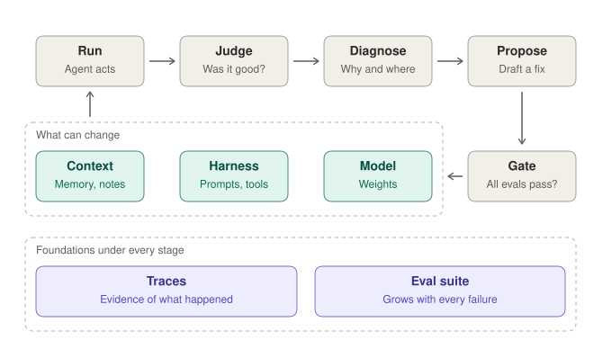

# Healer

Healer is a demo that runs on your own machine and shows how a self-improving AI agent works. A support agent for a fictional shop answers customers, while a learning loop judges every conversation, works out what went wrong, proposes a change to the agent, and keeps the change only if a growing set of tests still passes. The shop front is the product, and the console shows everything happening under the hood.



## Quick start

You need Node 26, npm, and an Anthropic API key.

Create your `.env` file from the example, then put your key in it as `ANTHROPIC_API_KEY`:

```bash
cp .env.example .env
```

Install dependencies:

```bash
npm install
```

Start everything:

```bash
npm run dev
```

- Shop front: http://localhost:3000
- Console: http://localhost:3000/console

Every model call is live and billed to your key. The console shows the running spend. A full pass through the walkthrough costs about $2.

## Where to read what

| File | What it is for |
|---|---|
| [demo-beats.md](demo-beats.md) | A step-by-step walkthrough of the whole demo, for someone new to the project and to the subject. Start here |
| [brief.md](brief.md) | The idea behind the project, the framework it teaches, how it was designed, and what the build found |
| [roadmap.md](roadmap.md) | Planned improvements and known defects, each written to be picked up without earlier context |
| [AGENTS.md](AGENTS.md) | Working rules for an AI agent making changes to this project |
| `notes.md` | The owner's inbox for feedback and requests. Local only, not in the repository |

## How it fits together

An agent is a model, wrapped in a harness, connected to context. Each of those three can change, and together they make one numbered agent version.

| Part | Folder | What it does |
|---|---|---|
| Agent package | `packages/agent` | The shared contract, a small hand-written graph runner, the support agent, its tools, and the shop's seed data |
| Shop service | `services/shop` | Serves the shop, runs the agent for customers, and records every conversation as a trace |
| Healer service | `services/healer` | The learning loop: judge, diagnose, propose, gate, promote. Also the eval suite, simulated customers, red teaming, and router training |
| Web | `web` | The shop front at `/` and the console at `/console` |

The two services share only two things: traces flow out of the shop, and new agent versions flow in. The shop knows nothing about the healer and keeps serving if it is stopped.

The loop runs on these models:

| Role | Model |
|---|---|
| The support agent | Starts on Claude Haiku 5.5. The loop can move it to Sonnet 5.5 or Opus 5.5 |
| Judge, diagnosis, proposals, red team | Claude Opus 5.5, held fixed so scores stay comparable |
| Simulated customers | Claude Haiku 5.5 |

## Configuration

All settings are environment variables. Only the key is required.

| Variable | Default | Purpose |
|---|---|---|
| `ANTHROPIC_API_KEY` | none | Needed for every model call. Without it the pages open but nothing can reply |
| `WEB_PORT` | `3000` | The web app |
| `SHOP_PORT` | `4311` | The shop service |
| `HEALER_PORT` | `4312` | The healer service |
| `HEALER_DATA_DIR` | `data` | Folder for both services' database files |

## Commands

| Command | What it does |
|---|---|
| `npm run dev` | Starts the shop service, the healer service, and the web app |
| `npm run typecheck` | Type-checks every workspace |
| `npm test` | Runs the unit tests. No API key needed |
| `npm run build -w @healer/web` | Builds the web app |

To run a second copy that cannot disturb the first, for example to test a change while a demo is in use:

```bash
WEB_PORT=3210 SHOP_PORT=4421 HEALER_PORT=4422 HEALER_DATA_DIR=data/verify npm run dev
```

## Reset

Press "Reset to factory" on the console's home page. It restores the shop's orders, clears all history, and puts version 0 of the agent back in the shop.

## Status

Built and working end to end on live models. Two things to know before relying on it:

- The router, the one part where model weights are really trained, has nothing useful to learn yet. The fix is designed and is item 1 in the roadmap.
- The judge, the diagnosis, and the proposals are written by models and vary from run to run. The walkthrough says what to do when a step goes differently.
