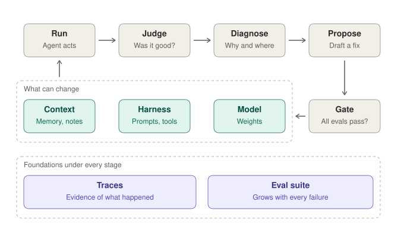

# Healer: product brief

Status: draft 7 (2026-11-13). Built and running on localhost. Section 7 records what the build found. Further development is tracked in `roadmap.md`.

## Summary

- **What it is.** A localhost demo in two tabs. The shop front is a small online shop with a support agent. The console shows everything happening under the hood as that agent gets better.
- **How you explore it.** The console home is a clickable map of the learning loop. Each block opens a deep dive with live data and the raw prompts behind it. There is no guided tour.
- **The idea it teaches.** An agent improves by changing one of three things (context, harness, model), and a growing set of evals decides which changes are kept.
- **How it runs.** Live Claude models. The agent starts on the smallest tier. A fixed, stronger model judges, diagnoses, and proposes fixes.
- **The model surface.** Shown twice: a simulated version (moving the agent up a model tier) and a real one (training a small local router on the demo's own traces).
- **How it is built.** TypeScript. A shop service and a healer service share one agent package. Traces flow out of the shop, new agent versions flow back in.
- **Where traffic comes from.** You chatting in the shop, simulated customers, and a library of known-tricky cases you can fire from the console.

## 1. Purpose

A small demo that runs on localhost and makes the idea of a self-improving agent easy to see and understand. The viewer should be able to watch an agent fail, watch the system learn from the failure, and see proof that it got better without getting worse elsewhere.

Success test: someone who has never built an agent can use the demo for ten minutes and then explain, in their own words, what a self-learning loop is, what can change inside an agent, and why evals are what make the change safe.

## 2. Source framework

From "How to Build Agents That Improve Over Time: Model, Harness, Context" (Harrison Chase, LangChain, Interrupt London, published 2026-10-27).

**An agent has three parts, and each one can improve.**

| Part | What it is | How it improves | Cost and speed | Who triggers it today |
|---|---|---|---|---|
| Model | The reasoning engine, plus smaller models at the edges (guardrails, judges) | Update weights. Supervised fine-tuning on good traces for narrow tasks. Reinforcement learning (tasks → rollouts → score → update) for complex ones | Expensive, slow | A human, almost always |
| Harness | The system around the model: what it sees, how actions run, verification, persistence, loop control | Change code, prompts, or tools | Medium. Affects every user | A background agent proposes, a human reviews |
| Context | Text and knowledge: memory, notes, skills, files | Rewrite text | Cheap, instant. Can be scoped per user, per org, or agent-wide | Can run in the background |

**Three levels of autonomy.** Manual (an engineer drives the cycle), human in the loop (a background process proposes, a human approves), fully automated (the stated North Star, not here yet).

**Two foundations under every loop.**

- Traces: the exact inputs, outputs, and sequence of every step. Vocabulary: run (one model or tool call) → trace (one task) → thread (one conversation). Agent failures are semantic, so they show up in traces and not in ordinary logs.
- Evals: the definition of what good looks like ("the new PRD"). Three hard parts: realistic inputs (which come from traces), defining good (exact match, or criteria applied to the final answer, the end state of the environment, or the sequence of tool calls), and a simulated environment so evals never touch production.

**Finding mistakes.** From production traces (reactive), from domain experts (manual), or by red teaming (proactive). There is no universal judge of correctness. One workaround: ask the same question two ways, and if the answers disagree, one of them is wrong.

**The flywheel.** Run the agent → get feedback (human or online judge) → inspect the trace → add the case as an eval data point → propose a change to model, harness, or context → confirm no regression → repeat.

**Hardest part, per the talk.** Choosing what to remember, what not to remember, and how to remember it.

## 3. How we think about it

This section is our synthesis. It builds on the talk and adds pieces the talk only gestures at.

### 3.1 One sentence

A self-improving agent is an agent plus a ratchet: every failure becomes a permanent test, and a change is only kept if it passes every test collected so far. Without the ratchet it is self-modification, not self-improvement.

### 3.2 Five questions every learning loop must answer

| Question | Mechanism | Stage in the loop |
|---|---|---|
| What happened? | Traces | Run |
| Was it good? | Feedback, judges, environment checks | Judge |
| Why did it go wrong, and which part is at fault? | Diagnosis (credit assignment) | Diagnose |
| What do we change, and for whom? | A surface (context, harness, model) and a scope (one user, one org, everyone) | Propose |
| How do we know it is better, and who signs off? | The eval gate and the autonomy dial | Gate, then promote |

### 3.3 The training analogy

A self-learning loop is training without touching the weights. Traces are the data. Evals are the loss function and the validation set. Diagnosis is the gradient. The proposed change is the update. Autonomy is the learning rate. The three surfaces are three groups of parameters with very different learning rates.

### 3.4 Loops nested by timescale

| Loop | Where the lesson lives | Persists? | Typical cadence |
|---|---|---|---|
| Self-correction inside one run (retry, reflect) | Nowhere | No. This is not learning, though it is often mistaken for it | Seconds |
| Context loop | Memory and notes | Yes, per scope | Minutes |
| Harness loop | Prompts, tools, code | Yes, for everyone | Days |
| Model loop | Weights | Yes, for everyone | Weeks |

Working rule (ours, not the talk's): fix at the cheapest surface that solves the problem, and escalate only when the same pattern keeps recurring.

### 3.5 What goes wrong

These are the nuances the demo should let the viewer trigger on purpose.

- Regression: a fix for one case breaks three others. The gate must catch it.
- Wrong diagnosis: the lesson is filed against the wrong surface or the wrong scope (a personal preference saved as a global rule).
- Memory rot: lessons pile up, contradict each other, or go stale.
- Unreliable judge: the judge is a model too, and can be wrong.
- Teaching to the test: the agent passes the evals and still fails real users.
- Noise mistaken for improvement: model output varies between runs, so a change only counts if it beats run-to-run variation. Each eval case runs several times, a case passes when most of its trials pass, and the gate compares the two versions case by case. That absorbs an off moment but hides a failure that happens one time in five, and more trials under a majority do not help. So cases that move money (a refund or a cancellation in the source trace or the expected end state) are marked strict, and when a change switches the model they run ten times on each side and pass only if every trial passes, stopping at the first failure. Each gate reason says what that could see: ten trials show a one-in-five failure 89% of the time. Model changes alter how reliably the agent acts, which is where such failures were seen; context and harness changes keep the majority rule.

## 4. Demo concept

The aim is not a guided tour. It is to show the workings under the hood, fully and clearly.

### 4.1 Two tabs, two roles

| Tab | Address | Who it is for | What it is |
|---|---|---|---|
| Shop front | `/` | The customer | The product itself. Pick a customer, see their orders, chat with the support agent, rate its replies. A thin shell, not a full store |
| Console | `/console` | The engineer | The workings of the shop front. Everything the learning loop sees, decides, and changes |

The shop front never shows any of the machinery. The console never needs the shop front's screen: it connects to it headlessly, through data only.

### 4.2 Console home: the concept map

The home page of the console is a live version of the framework diagram in section 3. Each block shows a current count and pulses while its stage is running. Clicking a block opens its deep dive.

Every deep dive has three layers: what the stage is (two or three sentences), its live data, and its raw workings (the exact prompt sent, the exact response, timing, and cost).

| Block | Its deep dive shows |
|---|---|
| Run | A live feed of conversations arriving from the shop, each opening its trace, and the agent graph with the route the latest conversation took through it |
| Traces | A diagram of where traces come from, then a run → trace → thread explorer. Every model call and tool call with exact input and output, and the trace's route drawn on the agent graph |
| Judge | The verdict on each trace: which check failed (answer criteria, end state of the database, tool sequence), any customer rating, and the judge's own prompt and reasoning |
| Diagnose | Failures clustered into issues. Each issue names a cause (knowledge, process, or capability) and the surface and scope it points at |
| Propose | Proposed changes as diffs, the approval queue, and the autonomy dial |
| Gate | Each candidate version run against the whole eval suite in a sandbox: pass rate before and after, results per case, cost per task, accepted or rejected. A proposal for one customer's preference that changes anything but that customer's notes is rejected without running the suite |
| Context | Memory by scope (shop-wide and per customer), with version history and diffs |
| Harness | System prompt and tool definitions, with version history and diffs |
| Model | The current tier with a manual picker, the router's training set, loss curve, held-out accuracy, and weights versions |
| Eval suite | Every case, the failure it came from, its checks, how it was tested before joining the suite, and its pass history across versions |

**Lineage.** Every object links to its neighbours, so one failure can be followed from the customer's message to the version that fixed it: trace → verdict → issue → proposal → gate run → version. Without this, a map of separate pages would hide the story of any single improvement.

**The console stands on its own.** It carries a live activity feed and can replay any conversation, so nobody has to watch two tabs at once.

### 4.3 Where failures come from

Without a tour, something has to produce traffic. One person chatting by hand makes a handful of traces, while clustering needs several similar failures and the router needs a few dozen labelled examples. Three sources:

1. **The viewer**, chatting in the shop front as any customer.
2. **A customer simulator.** Headless customers played by Claude send realistic messages through the same chat interface real customers use. Started from the console, for example "send 20 customers".
3. **Seeded cases.** A small library of known-tricky customers that can be fired one at a time from the console. This is not a tour: there is no order and no scripted outcome. It guarantees each concept can be reproduced on demand.

Those three are customer traffic: each message goes through the live shop and is graded by the judge. The healer also makes traces of its own, in a sandbox on a copy of the shop's records, and these never touch the live shop. There are three kinds, each graded a different way: eval trials (graded by the eval case's checks), red team probes (an original message and its paraphrase, compared with each other), and router replays (compared in code with the stronger tier). Once a gate has run, most traces are sandbox ones. The Traces page draws all six sources with a count for each.

### 4.4 Architecture

Three parts, started with one command.

| Part | What it does | Connection |
|---|---|---|
| Agent package | The graph runner and the support agent, as a function of (agent version, environment, message) that returns a reply and a trace. Shared code, not a service | Imported by both services |
| Shop service | Serves the shop front, holds the live order database, runs the agent on the current version, emits every trace | Sends traces out. Reads the current agent version |
| Healer service | Serves the console. Ingests traces, then runs judge, diagnose, propose, and gate. Owns the eval suite, the sandbox, the version registry, router training, and the customer simulator | Receives traces. Publishes versions |

- The contract between the two services is narrow: traces flow out of the shop, versions flow in. The shop knows nothing about judges or evals and keeps working if the healer is stopped.
- One limit on "headless": observing is headless, but the gate has to run the agent itself, on candidate versions, in a sandbox. That is why the agent is a shared package and not locked inside the shop service.
- The loop is a small hand-written graph in TypeScript with no framework: nodes, edges, and shared state. The graph defined in code matches the console's concept map one to one.
- State lives in a local database file. A "reset to factory" control returns the agent to version 0 and clears the history.
- A cost meter in the console shows API spend for the session by role. Checks that can be done in code are done in code, and the model judge is used only where judgement is needed.

### 4.5 Scenario, models, and coverage

**Scenario.** A support agent for a fictional online shop, working against a mock order database that resets for every eval run. It starts deliberately under-informed and on the smallest model tier, so its failures have three distinct causes that the loop must tell apart: missing knowledge (fix the context), loose process (fix the harness), and not enough capability (change the model).

**Models.** The Claude roles call the live API. The router runs locally.

| Role | Model | Why |
|---|---|---|
| The agent being improved | Starts on Claude Haiku 5.5 (`claude-haiku-5-5`). The loop can move it to Claude Sonnet 5.5 (`claude-sonnet-5-5`), then Claude Opus 5.5 (`claude-opus-5-5`) | Tiers differ visibly in capability and in price, so both the gain and its cost show up on the scoreboard |
| Judge, diagnosis, proposal | Claude Opus 5.5, fixed | The teacher should be stronger than the student, and the judge must not change between versions or scores stop being comparable |
| Router | A small classifier trained locally on the demo's own traces | Learns which requests carry risk and sends those to the stronger model. The only place where weights really change |
| Simulated customers | Claude Haiku 5.5 | Bulk message writing, where a small model is enough |

**How the model surface is shown.** Two mechanisms, one simulated and one real.

*Simulated: switching the main model.* Claude itself cannot be fine-tuned inside this demo, so a move up the tier ladder stands in for "the weights got better".

- Tiers, not adjacent versions. Two neighbouring versions of a top model would both pass a small eval suite, so the improvement would be invisible.
- The loop proposes the switch. Diagnosis must first classify a failure as a capability gap, meaning the trace shows the agent had the right knowledge and instructions and still got it wrong. The gate then shows pass rate next to cost per task.
- A manual model picker is also available for free play, so the viewer can try any tier and watch the scoreboard move.

*Real: training a small local classifier.* Moving every request to a bigger model fixes the hard cases and overpays for the easy ones. A small router learns which requests carry risk and sends those to the stronger model, while lookups and questions stay on the small one. It is trained on the demo's own traces, which makes it a genuine case of supervised fine-tuning at toy scale.

- Training data: real customer messages replayed in a sandbox, four times on the small model and once on the large one. A request is labelled as needing the large model for one of two reasons, and the dataset records which. High stakes: any replay attempted a tool that moves money or cannot be undone (a refund or a cancellation), even one a guard blocked. Measured failure: a small-model replay broke a policy rule or contradicted the large model's replay, and the large model's replay kept every rule. Measured failure is recorded when both apply. No model judge is involved, so the labels are cheap and repeatable.
- Why risk and not failure alone: once the rules are in context the small model fails too rarely to learn from, so the router learns how much a failure would cost instead. Every error the build measured falls inside the risky class.
- The model: a bag-of-words classifier that trains in under a second on a few dozen examples. The viewer sees the training set, the loss curve, accuracy on held-out cases, and a new weights version.
- The gate applies to weights too. A router that sends hard cases to the small model lowers the pass rate and is rejected, and so is one that sends any capability case to the small model. A routed candidate changes the model, so its strict cases run ten times and must pass every trial. A good one holds the pass rate and cuts cost per task, and the gate states what share of the dataset it sends to each tier.
- The customer simulator in section 4.3 supplies enough traffic to grow the training set.

Build risks:

- The hard eval cases that separate the tiers must be found by experiment. If the smallest model passes everything, the cases get harder or the ladder starts from an older model.
- With only a few dozen examples the router will be rough. That is acceptable as long as the gate keeps bad versions out and the screen says the scale is a toy.

**Situations the demo must be able to produce.** Not a script and in no fixed order. Each is backed by a seeded case so it can be reproduced on demand.

| # | Situation | Concept it shows |
|---|---|---|
| 1 | Agent refunds an order that is outside the refund window | Failure detected by checking the end state of the environment |
| 2 | The trace is opened and the failure is diagnosed as a knowledge gap | Traces, diagnosis |
| 3 | A policy note is added to shared context, and the case becomes an eval | Context learning at org scope, the eval suite growing |
| 4 | A customer states a personal preference, and it is saved for that customer only | Context learning at user scope |
| 5 | Several traces show refunds issued without looking up the order first. They are clustered into one issue and a prompt or tool change is proposed as a diff | Harness learning, tool-sequence criteria, human approval |
| 6 | An over-broad fix is proposed and the gate rejects it because older evals now fail | The ratchet, regression |
| 7 | A hard case keeps failing even though the trace shows the agent had the right knowledge and instructions. It is diagnosed as a capability gap, a move to the next model tier is proposed, and the gate shows pass rate against cost per task | The model as a surface, telling causes apart, the price of the most expensive lever |
| 8 | The router is trained on labelled traces, so easy requests go back to the small model. Cost per task drops while the pass rate holds | Real supervised fine-tuning at toy scale, traces as training data, held-out validation |
| 9 | The same question is asked two ways and the answers disagree | Red teaming without a universal judge |
| 10 | The autonomy dial is turned from manual to approve to automatic, and the loop runs on its own | Autonomy levels, the North Star |

**Concept coverage.** Model, harness, context. User, org, and global scope. Runs, traces, threads. Human feedback and online judge. Exact match and criteria evals on answer, end state, and tool sequence. Simulated environment. Issue clustering. Regression gate. Versioning and rollback. Red teaming by consistency probe. Three autonomy levels.

## 5. Decisions

### Settled

- **Live model.** The agent and the loop run on live Claude models. The API key is supplied by the owner in a local `.env` file that is never committed.
- **Model surface.** Both mechanisms are in. Switching the main model across tiers is the simulated improvement, proposed by the loop and also available as a manual picker. Training a small local classifier on traces is the real improvement.
- **The classifier's job.** A router that learns which requests carry risk and sends those to the stronger model, while the rest stay on the small one. Decided on 2026-11-13, because measured failures of the small model are too rare to learn from. This gives the classifier a real role and ties it to model switching.
- **Scenario.** A support agent for a fictional online shop.
- **No guided tour.** The demo shows the workings under the hood. The console home is a clickable concept map, and each block opens a deep dive.
- **Two tabs.** The shop front at `/` is the product. The console at `/console` reflects its workings and connects to it headlessly. More than one service is allowed.
- **The loop in code.** A small hand-written graph, no framework.
- **Language.** TypeScript.

- **Traffic sources.** The viewer, a customer simulator, and seeded cases (section 4.3).

### Assumed

- **Reading of "home page".** Taken to mean the home of the console. The shop front stays at `/`. Stated to the owner and not contradicted. Cheap to swap.

### Open

None. The router's training signal was decided on 2026-11-13: it will learn which requests carry risk, not which ones the small model fails. That work was built and run live on 2026-11-15 (section 7). Further development is tracked in `roadmap.md`.

## 6. Out of scope

- Fine-tuning or reinforcement learning of the Claude models themselves. Real training happens only on the small local router.
- A full storefront. The shop front is an orders list and a support chat, with no catalogue or checkout.
- A guided tour or scripted walkthrough.
- Multi-user accounts, authentication, deployment. Customers are picked from a list.
- Production-grade observability. Traces live in a local file or local database.

## 7. What the build found

How to run it is in `README.md`. This section records what turned out differently from the plan.

**Works as designed, proven on live models.**

- The full loop: a failed conversation is judged, diagnosed, turned into an eval case, fixed by a proposed change, gated, and deployed to the shop. Checked from the seeded late-refund case and from an unscripted chat in which the agent invented a currency.
- The ratchet: a hand-written note saying "never issue refunds" is rejected because earlier cases regress.
- All three surfaces change: context notes at shop and customer scope, harness changes, and a tier switch.
- All three autonomy modes, rollback, the red-team probe, simulated customers, and seeded cases.
- The separation of services: the shop keeps serving with the healer stopped, and the healer catches up afterwards.

**Different from the plan.**

- **The capability gap between tiers is narrow.** With the shop's rules in context, the small model matches the large one on ordinary requests. It errs only on the hardest ones, such as three orders in one message, and there only about once in 17 tries when last measured. The tier switch therefore buys the removal of a rare error at about 17 times the cost per task.
- **The router learns risk, not measured failure.** It was built to learn which requests the small model fails, and that had nothing to learn from: across 160 replays the small model never contradicted the large one, so the training set had no positive examples and training refused to run, and runs that found a single one produced a router that sent everything to the small model. The labelling was therefore changed: a request now also needs the large model when any replay attempted a refund or a cancellation, and the dataset records which reason applied. On a live run from a factory reset (the seeded cases, 30 simulated customers, then a dataset of 40), 15 of 40 requests carried risk: 10 as measured failures and 5 as high stakes. Measured failures were common because the factory version has no shop rules in context, so the small model refunded or cancelled where the large one escalated or declined. Training ran, but on 31 examples the router learned wording, not risk: it scored 100% on training and 44% on 9 held out, caught 1 of 3 risky held-out requests, and its strongest words were "not", "it", "panels" and "two" rather than "refund" or "cancel". Gated against the same version on the large model, the routed version passed (pass rate 83% to 100%, cost per task $0.0099 to $0.0017), but it sent the status question to the large model and the clean refund and the cancellation to the small one. The gate has no check that money-moving requests reach the large model, so a router can pass it by being cheap. Strict cases, added later, now run such requests ten times on a routed candidate and reject it if one trial fails, but a router that sends them to the small model still passes when the small model gets all ten right.
- **A refusal is labelled low risk, and refusals are common.** A request the agent correctly refuses, such as a refund outside the window, is labelled low risk when no replay attempted the refund. Traffic uses up the live shop's refundable orders, so on the live run 20 of the 25 low-risk requests asked for a refund, return or cancellation that the agent declined, found already done, or passed to a person. "Refund" therefore appears on both sides and cannot separate them, and the router kept 17 of those 20 on the small model. It was expected to send such requests to the large model because of their wording; it did not. The Model page states the weakness.
- **The agent learns shop policy from failed checks, not from a document.** Policy lives only as code checks in the healer. The proposer sees the wording of a failed check and writes the note from that, one rule at a time.

**Known limits.**

- Refunds that are too small, or never issued, break no policy rule, so a separate check catches them. The judge model reads which items the customer asked to return and whether they said to go ahead, and code works out what was owed under shop policy. The check fails when the refund falls short, when nothing was refunded although the customer said to go ahead and nothing was escalated, or when more than $150 was owed and the agent neither refunded nor escalated. It is only as good as the judge's reading: an item left out understates the amount owed, so a short refund can pass, and an item added makes a correct refund fail. Items whose return depends on a condition the customer set are left out, so in "A return that depends on the amount" the check catches the agent refunding nothing, but not the agent refunding $30.60 and ignoring the condition. Diagnosing such a failure writes an eval case that requires exactly $30.60, although the condition was met and $72.51 was owed. Testing the new case sets that check aside, because an agent shown every rule refunds the larger amount, but the case is then left with no refund check. The trace page shows the request the judge read so these mistakes can be seen. If the judge names an order or item that is not in the records, the check is not applied.
- The judge and the diagnosis are models and vary. Diagnosis sometimes writes a check that is too strict, which would make the gate reject every correct fix. Each new case is therefore tested before it joins the suite: an end state check that demands what shop policy forbids is set aside in code, and the case runs twice on a reference agent, a stronger model shown every shop rule that is used only for this test and never deployed, so the agent under test still learns the rules only from failed checks. A check that fails both reference runs is set aside, one that fails one run is flagged, and a person can put any set-aside check back. Two runs can miss a check that is too strict only some of the time, a rubric can be set aside because its grader was wrong, and the reference agent can fail a correct check on the hardest requests, so the eval case page shows every decision. A check that is too strict only now and then can still make the gate reject a good fix until it is edited and the proposal is proposed again.
- A failure rate of one in five is invisible to a gate running two or three trials per case under a majority. Strict cases make it unlikely, not impossible, and only where they apply: ten trials still miss a one-in-five failure 11% of the time and catch a one-in-seventeen failure (three orders in one message) only 45% of the time; a strict case that already fails on the base cannot regress, so the gate cannot use it; and gates for context and harness changes still use the majority rule. On the isolated copy the every-trial rule cut both ways. A shop note about opened items made Sonnet ask whether the watering can had been opened instead of refunding it, so "Clean refund inside the window" failed on the Sonnet base and the gate could not use it for a switch to Haiku. And a router that sent the cancellation case to Sonnet, the base's own model, was rejected because Sonnet failed one of seven trials it had passed ten of ten times on the base: one rare failure can reject a model change by chance.
- Traffic changes the shop's live orders, so most seeded cases behave as described only after a reset.
- Seeded cases can pass when the small model happens to get them right.
- The default autonomy is "approve", so traffic alone starts paid judging, diagnosis, and gating. The console shows spend by role.
- Performing the full walkthrough found further defects. The first batch was fixed on 2026-11-13. What remains is listed in `roadmap.md` under "Defects to fix".

**Cost.** Live testing during the build spent about $11.50. The judge is the largest share. A single failure taken from chat to deployed fix costs roughly $0.30 at three trials per case.

## 8. Change log

- 2026-11-11: Draft 1. Source framework captured from the talk, thinking framework proposed, demo concept and open decisions drafted.
- 2026-11-11: Draft 2. Live Claude model confirmed. Model surface changed from a trained local classifier to a model switch, with a tier ladder, a loop-driven switch, and a visible training set proposed. Model roles added. Storyline grew to ten steps.
- 2026-11-11: Draft 3. Small local classifier restored as a trained router alongside model switching. Manual model picker added. Summary added at the top. Framework diagram saved to `docs/self-learning-loop.svg` and embedded in section 3.
- 2026-11-11: Draft 4. Router confirmed. Scenario, hand-written graph, and TypeScript settled. Guided tour dropped. Demo concept rewritten around two tabs (shop front and console), a clickable concept map with deep dives, lineage between objects, and a three-part architecture. Customer simulator and seeded cases proposed as traffic sources.
- 2026-11-11: Draft 5. Traffic sources confirmed. No open decisions remain. Build started.
- 2026-11-11: Draft 6. Build complete. Added section 7 with what the build found. Router labelling description updated to match what was built. Router training signal reopened as a decision.
- 2026-11-13: Draft 7. Router decision made (route by risk) and moved to `roadmap.md`. Leftover scaffolding deleted. README cut to the basics and `demo-beats.md` added as a verified walkthrough. Roadmap extended with four proposed items and the defects the walkthrough found.
- 2026-11-13: First batch of walkthrough defects fixed (see "Done" in `roadmap.md`). The services can now run as a second, isolated copy for testing.
- 2026-11-15: The console draws a trace's route through the agent graph and the six sources of traces (see "Done" in `roadmap.md`). Section 4.3 now names the three sandbox sources next to the three kinds of customer traffic.
- 2026-11-15: The judge now checks that the customer got the refund they were owed: the judge model reads the request and code works out the amount (see "Done" in `roadmap.md`). The known limit about small or missing refunds in section 7 now describes the check and its weakness.
- 2026-11-15: The router now learns which requests carry risk, with a reason recorded per example (see "Done" in `roadmap.md`). Sections 4.5, 5 and 7 describe the new labelling and what its live run found: both classes appear, but the router learned wording rather than risk.
- 2026-11-15: A new eval case is tested before it joins the suite: against shop policy in code, on its source trace, and on a reference agent shown every rule that is never deployed (see "Done" in `roadmap.md`). The known limits about over-strict checks and the owed-refund check in section 7, and the Eval suite row in section 4, describe it.
- 2026-11-15: Cases that move money are strict: when a change switches the model they run ten times on each side under the every-trial rule, and the gate says what that could see (see "Done" in `roadmap.md`). Sections 3.5, 4.5 and 7 describe it and its limits.
- 2026-11-15: Three small defects fixed (see "Done" in `roadmap.md`): Discard is enabled only where the server accepts it, an `end_state` refund check allows a difference of one cent, and a proposal for one customer's preference that changes anything but that customer's notes is rejected without running the suite. The Gate row in section 4 says so.
