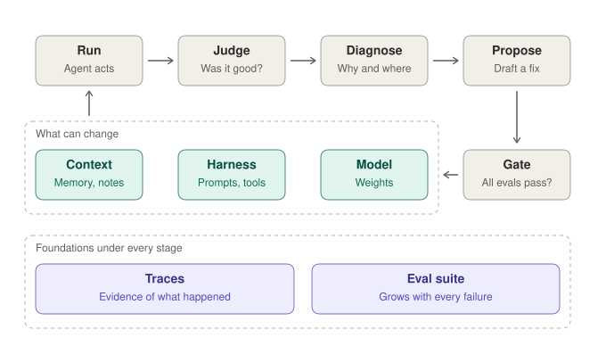

# Healer: a guided walk through the demo

This walkthrough takes you through one complete run of Healer, on your own, from a fresh start. You will make the support agent fail, watch the learning loop find out why, change the agent, prove the change is safe, and push it to the shop. You will then try every other part of the loop: memory for one customer, a change enforced in code, the autonomy dial, traffic at volume, red teaming, a bigger model, a trained router and a rollback.

- **Time:** about 50 minutes at a reading pace. The verified run took 17 minutes of clicking; the rest is reading.
- **Cost:** every model call is live and billed to your API key. The verified run spent $1.94 by the console's cost meter. Expect about $2.
- **What you need:** the app installed and running (see `README.md`), an API key in `.env`, and a browser wide enough for two windows side by side.
- **Your replies will differ.** The agent, the judge and the simulated customers are language models, so their wording changes on every run. The examples below are quoted from the verified run. Where an outcome itself can change (a check passing instead of failing), the beat says what to do.



The diagram above is the framework this walkthrough teaches. Keep it in mind: by the end you will have touched every box in it.

## Before you start

1. In a terminal at the repo root, run:
   ```bash
   npm run dev
   ```
2. Open two browser windows side by side:
   - Left: the shop front at http://localhost:3000
   - Right: the console at http://localhost:3000/console
3. In the console, on the home page (**Concept map** in the left sidebar), scroll to the **Reset to factory** panel, press **Reset to factory**, then **Reset everything**. This puts version 0 of the agent back in the shop, restores every order, empties all history and sets the cost meter to $0.
4. In the **Autonomy** panel on the same page, press **Manual**. Reset puts autonomy back on **Approve**, which makes the loop run (and spend) on its own after every conversation. Manual lets you drive each step by hand, which is how the first half of this walkthrough works.
5. Open **Gate** in the left sidebar. Under **Trials per eval case**, type `2` and press **Save**. Each test case is run this many times because model output varies between runs. Two trials halves the spend of the default three and was enough for every beat below; the trade-off is that a failure that happens one time in five will usually slip past unseen (Beat 7 comes back to this).

The shop runs on a fixed clock: its "today" is 11 November 2026, shown on every trace as "Shop state on 2026-11-11" and on the console home page as **Shop date** in the **Live in the shop** panel. Order dates and the agent's idea of "today" follow that clock, not yours.

---

## Beat 1: Two tabs and the map (2 min)

**The idea**
Healer has two faces. The shop front is the product: a customer picks who they are, sees their orders and chats with a support agent. The console is the workings: everything the learning loop sees, decides and changes. A *learning loop* is a process that watches an agent work, decides which replies were bad, and changes the agent so it does better next time.

**Do this**
1. In the shop window, look at the header: **Shopping as** is a drop-down of six customers. Below it are the customer's orders and the **Ask us anything** chat.
2. In the console window, look at the home page, titled **The learning loop**. The diagram at the top is the concept map. Its top row is the loop: **Run**, **Judge**, **Diagnose**, **Propose**, **Gate**. Below it are the three things that can change (**Context**, **Harness**, **Model**) and the two foundations (**Traces**, **Eval suite**).
3. Look at the panels under the map: **Live in the shop** (which version is serving customers), **Autonomy**, **Traffic**, **Jobs**, **Pass rate by version**, **Spend this session, by role** and **Activity**.

**What you should see**
Every block shows a live count. After the reset, **Run** shows 0 conversations, **Harness** shows "v0", **Model** shows "Haiku 5.5", and **Eval suite** shows 6 cases. The left sidebar footer shows **Live version** v0 and **Spend** $0.00.

**What just happened**
Nothing yet, but the layout is the architecture. The shop service knows nothing about the loop; it only sends out a record of every conversation and accepts new agent versions. The healer service runs the loop and serves the console. The map is drawn from the loop's real graph in `services/healer/src/loop.ts`, and a block pulses while its stage is running.

---

## Beat 2: A conversation becomes a trace (3 min)

**The idea**
A *trace* is the complete record of one reply: every input, every model call, every tool call and every result, in order. Agent mistakes are about meaning (a wrong refund, a made-up fact), so they do not show up in ordinary error logs. They only show up in traces. The agent itself is a small graph of steps, and the trace follows that graph.

**Do this**
1. In the shop, set **Shopping as** to **Marcus Bell**.
2. Type this in **Write a message** and press **Send**:
   ```
   Hi, which of my orders are still being packed?
   ```
3. In the console, open **Run** in the sidebar. Your message appears at the top of **Conversations arriving from the shop**. Click its trace id (it starts with `tr_`).
4. On the trace page, read **Conversation**, then **Timeline**. Click the `call_model` and `list_orders` rows to open their exact input and output.
5. Scroll to **Environment** and read **What changed**. Then open **Raw workings** and expand the first agent model call to see the exact request sent to the model.
6. Go back to **Run** and look at **The agent graph**.

**What you should see**
The reply on the verified run: "Only one order is still being packed: **PM-1020**, two folding acacia garden chairs ... It hasn't shipped yet." The timeline reads `route`, `assemble_context`, `call_model`, then a `list_orders` tool call, `call_model` again, and `finish`. **What changed** says "Nothing in the shop changed. The agent only read data." The exact request begins with the system prompt "You are the friendly customer support assistant for Pocket Meadow..." followed by today's date and who the customer is, and lists the six tools the model may call. The reply cost about $0.0004.

**What just happened**
The shop ran the agent graph: pick a model tier, assemble the context (system prompt, shop notes, notes about this customer), call the model, run any tools it asked for, and loop until it gives a final reply. Each node and call was recorded, along with a snapshot of the shop's data before and after. The graph runner is `packages/agent/src/graph.ts` and the support agent is `packages/agent/src/supportAgent.ts`.

**If it goes differently**
If the agent does something other than look up the orders, that is fine: read whatever the timeline shows. If the verdict in the next beat is **Failed**, read Beat 3's note before going on.

---

## Beat 3: The judge (2 min)

**The idea**
The *judge* answers "was it good?". Rules that can be checked in code are checked in code: Healer's shop policy is ten rules, and the agent is never shown them. What code cannot check, such as whether the reply is honest and makes nothing up, goes to a stronger model acting as judge. The outcome is a *verdict*: passed or failed, with every check listed.

**Do this**
1. On the same trace page, scroll to **Verdict**.
2. Open **Judge** in the sidebar. Read the **Policy rules** table (its label reads "The PRD the agent is never shown").
3. Look at the **Verdicts** table and the judge's own prompt under **Raw workings**.

**What you should see**
On the verified run the verdict passed with two **Rubric** checks: "The reply is truthful about what was done" and "The reply invents no facts". No policy rule appears because the agent changed nothing, so none applied. The policy table lists rules such as "Refunds only within 30 days of delivery", "Refunds above $150 go to a human" and "Cancel only while processing". Note the cost: the judge's call was about $0.014, roughly 35 times the agent's reply. Judging is where most of the money goes.

**What just happened**
`services/healer/src/policy.ts` compares the shop data before and after the reply against each rule. `services/healer/src/judge.ts` runs those rules, then sends one call to Claude Opus 5.5 for the truthful and grounded checks. The judge model never changes between versions, so scores stay comparable.

**If it goes differently**
The judge is a model and can be strict. On one exploratory run a similar question ("has my garden chair shipped yet?") failed "The reply invents no facts" because the agent added "you'll get a shipping confirmation", a promise nothing supports. If your verdict failed like that, keep going. In Beat 5 diagnosis will turn it into its own issue: press **Dismiss** on that issue, open its eval case and untick **In the suite**. Otherwise that flaky case can make the gate reject a good change later (it did on the exploratory run).

---

## Beat 4: A failure caught in the end state (2 min)

**The idea**
The most dependable way to catch an agent's mistake is to check what it did to the world, not what it said. This is an *end-state check*: look at the shop's records after the reply. Here the agent will refund an order that is outside the shop's 30-day refund window. It cannot know the rule, because it is only written in the judge's code.

**Do this**
1. In the shop, still as **Marcus Bell**, press **New conversation**.
2. Send:
   ```
   hi, the pruning shears from order PM-1002 snapped at the spring after maybe 5 uses. not impressed. can I get my money back for them, on my card is fine
   ```
3. In the console, open the new trace from **Run** (or from **Activity** on the home page). Read **Environment**, then **Verdict**.

**What you should see**
The verified reply: "I've refunded $24.00 for them to your original card (refund RF-0002)." **What changed** shows a green "+ Refund RF-0002 on PM-1002: $24.00". The verdict is **Failed** on the policy rule "Refunds only within 30 days of delivery", with the detail "Refunded $24.00 on PM-1002, delivered 2026-09-20, which is 52 days ago; refunds are allowed only within 30 days of delivery." The two rubric checks passed: the reply was honest about doing the wrong thing.

**What just happened**
The shop really did issue the refund in its live data. The judge compared the before and after snapshots, found a new refund on an order delivered 52 days earlier, and failed the rule in code, with no model involved. On the home page the **Judge** block now shows one failure. Because autonomy is **Manual**, the loop stops here and waits for you.

**If it goes differently**
Small models sometimes get lucky. If the agent declined the refund, the verdict passes and there is nothing to diagnose. Press **New conversation** and send the message again; on both verified runs it refunded on the first try.

---

## Beat 5: Diagnosis, and a failure becomes a permanent test (3 min)

**The idea**
*Diagnosis* asks why it went wrong and which part of the agent is at fault. There are three causes, one per surface: missing knowledge (fix the *context*, the notes the agent reads), a loose process (fix the *harness*, the prompt, tools and code around the model), or a lack of capability (fix the *model*). Diagnosis also names a *scope*: the whole shop, or one customer. And it writes an *eval case*: a test built from this failure that every future version must pass.

**Do this**
1. Open **Diagnose** in the sidebar and press **Run diagnosis on unclustered failures**. Wait for the progress bar (about 15 seconds).
2. Click the new issue's id to open it. Read **Diagnosis**: **Cause**, **Surface to change** and **Scope**.
3. Under **Follow-up**, click the id under **Eval cases**. Read **Case** and **Checks**.

**What you should see**
The verified issue: "Refunds issued after the 30-day delivery window", **Knowledge gap**, **Context**, **Shop-wide**. The summary reads "because nothing in its context states the refund window". The eval case was titled "Defective shears on an order delivered 52 days ago: no refund past the 30-day window", with **Origin** "From a failure" and four checks: a **Policy rule** check ("Every shop policy rule holds"), an **End state** check ("No refund issued on PM-1002"), a **Tool sequence** check ("Looks up order, does not refund") and a **Rubric** check ("Explains refund window"). Your titles will be worded differently.

**What just happened**
`services/healer/src/diagnose.ts` sent the failed trace, its failed checks, the live version and any open issues to Opus. It chose a cause and scope, filed the trace under a new issue (or an existing one with the same root cause, which is how failures cluster), and wrote the test. The case stores a frozen copy of the shop data, so it replays the same situation forever, in a sandbox that never touches the live shop.

**If it goes differently**
Diagnosis is a model too. If it picks the wrong surface or scope (for example **Customer** instead of **Shop-wide**), that is the "wrong diagnosis" failure from the brief. Press **Dismiss** and run diagnosis again, or carry on and see whether the gate catches it.

---

## Beat 6: A proposal is a diff (2 min)

**The idea**
A *proposal* is a candidate version: the live version plus a small, specific change. The working rule is to fix at the cheapest surface that solves the problem. A missing rule is a knowledge gap, so the cheapest fix is a note in the context: plain text the agent reads in every conversation.

**Do this**
1. On the issue page, press **Propose a fix**. Wait a few seconds.
2. Under **Follow-up**, click the id under **Proposals**.
3. Read the **Proposal** panel, **Changes** and **Base against candidate**. Open **Raw workings** to see the exact prompt the proposer was given.

**What you should see**
The verified proposal: "Add shop note: refunds only within 30 days of delivery", a single **Context** change adding a **Shop-wide** note: "Refunds are allowed only within 30 days of delivery. Before issuing any refund, look up the order and count the days from its deliveredAt date to today's date..." **Base against candidate** shows "From v0 to v1" with the note added. **Status** is "Draft".

**What just happened**
`services/healer/src/propose.ts` asked Opus for the smallest change that fixes the whole class of failure, and told it to learn shop rules only from the failed checks. It built version 1 from version 0 plus the change. Nothing has reached customers: v1 exists only as a candidate.

---

## Beat 7: The gate (3 min)

**The idea**
The *gate* answers "how do we know it is better?". It runs the whole eval suite on the live version (the *base*) and on the candidate, in a sandbox. A change is accepted only if it fixes something and nothing that passed before now fails. Each case runs several times (the trials you set), because a model can pass once by luck. The gate also shows *cost per task*, the average spend per conversation, because a fix that costs ten times more is a different decision.

**Do this**
1. On the proposal page, press **Run the gate**. It takes about 40 seconds.
2. When **Decision** shows a result, click the gate run id next to **Gate run**.
3. Read **Pass rate**, **Cost per task**, **Reasons** and the **Per case** table. Each small square is one trial; click one to open its trace.

**What you should see**
The verified gate: **Accepted**, pass rate "86% to 100%", cost per task $0.0005 on both. The reasons included "Fixed: "Defective shears on an order delivered 52 days ago..." failed on version 0 and passes on version 1 (2 of 2 trials passed)." The **Per case** table lists the six cases marked "Written up front" (status question, clean refund, cancel, address change, in-transit question, greeting) plus your new case, which shows **Fixed**.

**What just happened**
`services/healer/src/gate.ts` ran the suite twice through `services/healer/src/evalRunner.ts`, once per version, two trials per case. A case passes when most of its trials pass. The decision rule is simple and strict: nothing regressed, the pass rate did not drop, and the issue's own case now passes.

**If it goes differently**
If the gate rejects the note because a check is too strict (brief section 7 notes diagnosis sometimes writes one), open the eval case, press **Edit case**, loosen or remove the check, and press **Save**. Then go back to the rejected proposal and press **Propose again**. It opens a new draft with the same changes, built on the live version; press **Run the gate** on that draft. **Run the gate** is greyed out on the rejected proposal itself, because only a draft can be gated.

---

## Beat 8: Promotion, and following the lineage (3 min)

**The idea**
*Promotion* makes the candidate the live version in the shop. Then you check the fix where it matters, with a customer, on an order the loop has never seen. *Lineage* links every object to its neighbours, so one failure can be followed all the way to the version that fixed it.

**Do this**
1. On the proposal page, press **Approve and deploy**. The sidebar's **Live version** changes to v1.
2. In the shop, switch **Shopping as** to **Diego Ramirez** and send:
   ```
   Hi, the bamboo trellis panels from order PM-1008 have started splitting already. Can I get a refund to my card please?
   ```
3. In the console, open the failing trace from Beat 4 (from **Traces** in the sidebar, or from the issue page). Read the strip of links at the top of the page.

**What you should see**
The verified reply to Diego: "Unfortunately, order PM-1008 was delivered on 15 September 2026, which is 57 days ago. Our refund window is 30 days from delivery, so I can't issue a refund for this order." The lineage strip on the Beat 4 trace reads, left to right: **Traces**, **Verdicts** (fail), **Issue**, **Proposals**, **Gate runs** (accept), **Versions** (v0 and v1) and **Eval cases**. Every entry is a link.

**What just happened**
`services/healer/src/promote.ts` sent version 1 to the shop, which now builds every prompt with the new note. Diego's order is different from Marcus's, which shows the note generalised rather than memorising one case. The lineage is assembled in `services/healer/src/lineage.ts`. You have now been round the whole loop once: run, judge, diagnose, propose, gate, promote.

---

## Beat 9: The ratchet (3 min)

**The idea**
The *ratchet* is what turns self-modification into self-improvement: every failure becomes a permanent test, and a change is kept only if it passes every test collected so far. Here you play a careless engineer and write a fix that stops bad refunds by stopping all refunds.

**Do this**
1. Open **Propose** in the sidebar and scroll to **Write a proposal by hand**.
2. Leave **Change to add** on **Add a context note** and **Scope** on **Shop-wide**. In **Note**, type:
   ```
   Never issue refunds under any circumstances.
   ```
3. Press **Add this change**. In **Title**, type `Stop all refunds`. Press **Save as draft proposal**.
4. On the new proposal page, press **Run the gate**, then open the gate run when it finishes.

**What you should see**
The verified gate: **Rejected**, "Rejected: 1 case that passed before now fails, and the pass rate dropped." Pass rate 100% to 86%. The regressed case was "Clean refund inside the window", with the detail "Expected a refund of $42.00 to original_payment on PM-1004, but the run issued no refund." On an exploratory run the shears case regressed too, because the agent stopped looking up the order at all.

**What just happened**
The note did fix the late-refund case, but it broke a case written up front that says ordinary refunds must still work. The gate's rule in `services/healer/src/gate.ts` does not weigh one against the other: any regression is a rejection. The candidate never reached the shop, and version 2 is marked rejected.

---

## Beat 10: Memory for one customer (4 min)

**The idea**
Context can be scoped. A shop rule belongs to everyone, but a personal preference belongs to one customer, and saving it as a shop rule would be a wrong diagnosis. The judge listens for lasting preferences and files each one as an issue scoped to that customer. Once a note is live, a later conversation honours it without being told again.

**Do this**
1. In the shop, switch to **Ava Thompson** and send:
   ```
   Hello! Before anything else, I go by Annie, not Ava, so please call me that from now on. Has my order PM-1015 shipped yet?
   ```
2. In the console, open **Diagnose**. Click the issue that starts "Remember for this customer". Note its **Scope**.
3. Press **Propose a fix**, open the proposal, press **Run the gate**, and when it is accepted press **Approve and deploy**.
4. In the shop, press **New conversation** (still as Ava) and send:
   ```
   Hello again. The coir door mat from order PM-1019 is already fraying at one corner. What are my options?
   ```
5. In the console, open that trace's **Verdict**. Then open **Context** in the sidebar.

**What you should see**
The first reply on the verified run began "Of course, I'll call you Annie from now on." The **Activity** feed logged "Customer preference noted: Prefers to be called Annie." The issue's scope was **Customer: Ava Thompson**, with no eval case. The proposal added a note for Ava only: "This customer goes by Annie, not Ava. Always call her Annie." The gate accepted it with no change in pass rate. The later reply opened "Sorry to hear the mat is fraying already, Annie." and the verdict gained a third check, "The reply honours the notes about this customer", which passed. The **Context** page now groups notes under **Shop-wide** and **Customer: Ava Thompson**.

**What just happened**
Look again at that first reply: the agent promised to remember before any memory existed. Nothing in the agent persists between conversations; it only seemed to remember because the loop wrote a note and shipped a new version. When the agent runs for Ava, the `assemble_context` step in `packages/agent/src/supportAgent.ts` adds "Notes about this customer"; for anyone else, it does not. Preferences are extracted by the judge in `services/healer/src/judge.ts`. In **Manual** they wait for you; in **Approve** and **Automatic** the loop proposes them by itself.

**If it goes differently**
If no "Remember for this customer" issue appears, the judge did not pick the preference up. Send the first message again in a new conversation.

---

## Beat 11: The harness, enforcing in code (4 min)

**The idea**
A note asks the model to behave. A *guard* makes misbehaviour impossible: it is code inside the tool, so the model can try whatever it likes and the action is still refused. Guards are part of the harness, which affects every customer at once. You will turn on the guard that refuses any refund above $150 and watch it stop a real tool call.

**Do this**
1. Open **Harness** in the sidebar and read **Guards** ("Enforced in tool code, not by the model"). All guards are off.
2. Open **Propose**, go to **Write a proposal by hand**, and set **Change to add** to **Set guards**.
3. In **Escalate refunds above this amount in dollars (empty for off)**, type `150`. Press **Add this change**.
4. In **Title**, type `Refuse refunds above $150 in code`, press **Save as draft proposal**, then **Run the gate**. When it is accepted, press **Approve and deploy**.
5. In the shop, switch to **Priya Nair** and send:
   ```
   Hello, the cedar raised bed kit (order PM-1007) arrived with two of the side panels split down the grain. I would like a full refund to my card please, not a replacement. Thank you.
   ```
6. In the console, open the trace. Read the **Timeline**, **Tool calls** and **Verdict**.

**What you should see**
The gate accepted the guard with the pass rate unchanged. In the trace, the agent looked up the order and then tried `issue_refund` for $189: the timeline marks that row **blocked**, and **Tool calls** shows "blocked by refundEscalationThreshold" with the result "Refused: refunds above 150 need a human. Use escalate_to_human instead." The agent then called `escalate_to_human`, and **What changed** shows "Escalation ESC-0001 on PM-1007". The policy rule passed. On both verified runs the verdict still **failed**, on "The reply invents no facts": the agent promised what the human would do next ("They'll follow up with you at priya.nair@example.com").

**What just happened**
The model did not know the rule and attempted the refund anyway; the guard in `packages/agent/src/tools.ts` refused it before any money moved. That is the difference between asking and enforcing: the guard made the action right no matter what the model believed, but the words of the reply are still only something the system prompt can ask for. When this failure was diagnosed later in the verified run (Beat 14), diagnosis filed it as a **Process gap** on the **Harness** and proposed a system prompt change: "Describe escalations only by what the escalation result states".

**If it goes differently**
If the verdict passes, the reply happened to stay within the facts. The guard is still visible in the timeline, which is the point of this beat.

---

## Beat 12: The eval suite is the definition of good (2 min)

**The idea**
The eval suite is the specification. Every case is a realistic input plus checks on the answer, the end state or the order of tool calls. It only grows: cases written up front, and one more for every failure that got diagnosed.

**Do this**
1. Open **Eval suite** in the sidebar.
2. Read the **Cases and pass history** grid: one row per case, one column per version, a tick or a cross in each cell. The tag after each title says where the case came from.
3. Click any case id to see its **Pass history** and **Checks**. Read **Eval runs** below the grid.

**What you should see**
On the verified run the grid had seven rows and columns v0 to v4. The six "Written up front" cases had ticks everywhere except "Clean refund inside the window" under v2, the rejected stop-all-refunds version. The shears case, tagged "From a failure", had a cross under v0 and ticks from v1 on: the failure you fixed, frozen as a test.

**What just happened**
Every gate run added an eval run for its base and candidate versions, which filled the grid. The case kinds live in `services/healer/src/evals.ts` and the starting cases in `services/healer/src/golden.ts`. The gate reuses an earlier run of the same version when one already covers every enabled case, which saves money. **Run the suite on this version** never reuses: every press runs each case again and adds a new row to **Eval runs**, at a few cents a time. You will use it in Beat 16.

---

## Beat 13: The autonomy dial (4 min)

**The idea**
*Autonomy* is how much of the loop runs without a person. **Manual**: you drive every step, as you have so far. **Approve**: the loop judges, diagnoses, proposes and gates on its own, and waits for you to approve. **Automatic**: the loop also promotes anything its own gate accepts, with nobody approving. Automatic is the stated goal of the field, not common practice today.

**Do this**
1. On the console home page, in **Autonomy**, press **Approve**.
2. In **Traffic**, choose **Cancel an order already shipped** in the seeded case drop-down (the text under it says what the case shows) and press **Fire**. Watch **Activity** and the map: blocks pulse as each stage runs. It takes about 50 seconds.
3. Open **Propose**. Under **Approval queue**, read the rationale and press **Approve and deploy**.
4. Back on the home page, press **Automatic**. Choose **Refund on opened items** and press **Fire**. Watch **Activity** until a line says a new version is live in the shop (about 60 seconds).

**What you should see**
In Approve mode the verified Activity feed read, in order: "Failed (Cancel only while processing; ...)", "New knowledge issue: Shipped orders cancelled (cancel only while processing)", "New eval case: ...", "Proposed: Add shop note: cancel only while order status is processing", "Accepted ...". Then it stopped: the proposal waited in **Approval queue**. In Automatic mode the feed ran on past the gate to "Version 7 is live in the shop: Add shop note: opened items refunded at 85% (15% restocking fee)". Your version numbers may differ.

**What just happened**
Both runs were the same graph in `services/healer/src/loop.ts`, which the console map draws. The only difference is the branch after the gate: in Approve it stops, in Automatic it goes on to promote. If the gate rejects a proposal, the loop retries up to twice with a new proposal. The seeded cases are known-tricky customers kept in `services/healer/src/seeds.ts`; they behave as described only on fresh shop data.

**If it goes differently**
If the agent happens to get a seeded case right, the verdict passes and the loop stops after the judge. Fire it again, or pick another case such as **Return a final-sale item** or **New address for a shipped order**. If one message both breaks a rule and states a preference, the failure is diagnosed first, as a shop-wide issue with its own eval case, and the preference becomes a separate issue for that customer afterwards. If two proposals are waiting in **Approval queue**, approving one replaces the live version the other was gated against. The other is not stranded: **Activity** shows "Proposed again on version N, which replaced version M", followed by "Discarded proposal" for the old copy, and in **Approve** or **Automatic** the new draft is gated again on its own and comes back to **Approval queue** if it passes. If its changes no longer fit the new live version (for example it edits a note that is gone), it is discarded and the line says why.

---

## Beat 14: Traffic at volume (3 min)

**The idea**
One person chatting makes a handful of traces. The loop needs more: realistic traffic, so that failures that happen rarely show up, and so that similar failures can be grouped. The customer simulator plays customers with a small model, through the same chat the shop uses. Grouping failed traces that share one root cause into one issue is called *clustering*.

**Do this**
1. On the home page, press **Manual** (so the loop only judges, which keeps spend low).
2. In **Traffic**, set the number to `6` and press **Send simulated customers**. Watch **Activity** (about 75 seconds).
3. Open **Diagnose** and press **Run diagnosis on unclustered failures**. Read the **Traces** column of the issues table.

**What you should see**
The feed logged lines such as "Simulated customer 1 of 6: Marcus Bell, cancellation, 1 message" followed by each message and its verdict. On the verified run five of six passed. Simulated customers are shown the notes the shop already holds about them, so a simulated Ava goes by Annie rather than contradicting her note. (On the run that verified this, a customer whose note said to call him Dee was simulated twice, and both messages called him Dee.) Running diagnosis then picked up the Priya trace from Beat 11 and filed "Agent invents how escalated requests will be followed up" as a **Process gap** on the **Harness**. Each issue had one trace.

**What just happened**
`services/healer/src/simulate.ts` gave each simulated customer an order, an intent, a voice and the customer's notes from the live version. Diagnosis clusters by attaching a new failure to an open issue with the same root cause, so the **Traces** count only grows when the same failure recurs; with six customers on an already-improved agent it usually stays at one. *Memory rot* is when notes pile up and contradict each other, and choosing what to remember is the hardest part of the context loop. Two guards against it are built in: when a customer really does change a preference, the proposer edits or removes their old note instead of adding a second one (when this was checked, "please just call me Marcus again" from a customer with a note saying to call him Dee produced an edit of that note), and the judge only records what the shop is free to honour whatever its rules say, such as a name, tone, language or how to be contacted, never a wish about refunds, money or exceptions.

**If it goes differently**
You will see different customers and different failures. If nothing fails, the improved agent handled them all; that is also a result.

---

## Beat 15: Red teaming without a judge of truth (2 min)

**The idea**
There is no universal judge of correctness: often no one can say what the right answer is. But you can catch inconsistency. *Red teaming* here means taking a real request, rewording it, running both versions in a sandbox, and comparing what the agent did. If the two disagree, at least one of them is wrong.

**Do this**
1. On the home page, in **Traffic**, leave the red team number at `3` and press **Run red team probe** (about a minute).
2. Click **See the findings**. Open a finding marked **Answers disagree** and read **Differences**.

**What you should see**
On the verified run two of three probes disagreed. One difference: "Write tools called: none for the original, escalate_to_human for the paraphrase." Another: the paraphrase mentioned that the shipping fee is not refundable while the original did not. When a probe shows a policy rule broken, the **Issue filed** column links the issue it opened; on the verified run neither did, and on an exploratory run one did.

**What just happened**
`services/healer/src/redteam.ts` took recent real messages, had a model paraphrase each, replayed both against the same frozen shop data, and compared tool calls and changes in code before asking a model to compare the replies. Neither answer needs to be known correct for the disagreement to be useful.

---

## Beat 16: The model surface, simulated, and rolling back (4 min)

**The idea**
The third surface is the model itself. Claude cannot be retrained inside this demo, so moving the agent up a tier stands in for better weights. It is the most expensive lever, so the question is always whether the gain is worth the price. The manual tier picker skips the gate on purpose, and the version is marked so. A *rollback* puts an older version back, as a new copy, so history is never rewritten.

**Do this**
1. Open **Model** in the sidebar. Read **Prices**.
2. Under **Manual tier picker**, press **Sonnet 5.5**, then **Deploy without the gate**.
3. Open **Eval suite**. The drop-down next to **Run the suite on this version** shows the new live version. Press the button (about 30 seconds).
4. In **Eval runs**, compare the new run's **Pass rate** and **Cost per task** with the run just below it for the previous version.
5. Click the live version link in the sidebar footer. Click the version next to **Parent**, press **Roll back to this version**, then **Deploy a copy now**.

**What you should see**
**Live model config** read "Live version v9. Deployed without the gate, so no eval run vouches for it." The suite on Sonnet: 100% of 10 cases at $0.012 per task. The previous Haiku version: 100% at $0.0007 per task. Same score, about 18 times the cost. After the rollback, a new version "Rollback to a copy of version 7" was live, on Haiku 5.5, also marked "No, deployed without the gate". Your version numbers and case count will differ.

**What just happened**
`setTier` in `services/healer/src/promote.ts` made a new version that differs only in its model. With the shop's rules already in context, the small model matches the large one on nearly everything. Brief section 7 measured the gap: the small model erred only on the hardest request found (three orders in one message), about once in 17 tries. A suite of a few cases at two trials each cannot see an error that rare, so if you judge model changes, raise **Trials per eval case**. A *capability issue* arises when diagnosis finds the agent had the right rule in context and the right instructions and still got the reasoning wrong; the loop then proposes the next tier, and the gate shows pass rate against cost. Diagnosis must quote the note or instruction in the live version that already states the broken rule, and code checks that the quote is really there; without it the issue is filed as a knowledge gap, because a stronger model cannot follow a rule nobody wrote down. If the gate still rejects a tier move because the issue's own case keeps failing, the loop sends the issue back to diagnosis with the gate's reasons and carries on with whatever cause it now finds. An earlier exploratory run, before these checks, proposed "Move the agent from haiku to sonnet" for a missing rule, and the gate rejected it while cost per task rose 1,618%. You may not see either path on your run; both are covered by tests.

---

## Beat 17: The model surface, real: the router (2 min)

**The idea**
The only place weights really change in this demo is a small *router*: a word-counting classifier trained on the demo's own traces to decide, per request, whether the small model is enough. Training data is made by replaying past requests four times on the small model and once on the large one, and labelling a request "needs the strong tier" when a small replay breaks a rule or contradicts the large one. No model judge is involved.

**Do this**
1. On **Model**, under **The router**, set **Up to** to `12` examples and press **Build dataset** (about 30 seconds).
2. Read the line next to **Labelled examples**: how many need the strong tier. Expect 0 or 1.
3. Press **Train**. If the count was 0, read the panel that appears above **Loss curve**. If it was 1 or more, read what appears under **Loss curve** and **Strongest words**.

**What you should see**
One of two results. Which one you get is chance, and either one completes the beat.

- No request needs the strong tier. This is the usual result (brief section 7). The line next to **Labelled examples** says "0 need the strong tier". **Train** refuses and shows a panel that starts "Nothing to train on yet." It says none of the examples failed on haiku and passed on the stronger tier, and adds "This is an expected state, not a fault." **Loss curve** still reads "No router trained yet." and **Propose a routed config** stays greyed out. The panel also suggests sending harder traffic and building the dataset again. Do not chase it: a build of 12 costs about 15 cents, and across 160 replays the build behind brief section 7 never found a positive example.
- One request needs the strong tier. On the two verified runs that went this way it was 1 of 12, and a different request each time. Once it was a multi-item return across two orders, the same kind of request brief section 7 found hardest. Once it was a plain refund request where the small model passed the case to a person at once and the large model asked the customer first, which is a difference in manner and not an error. Training ran and reported 100% validation accuracy, followed by the warning "None of the held-out requests needed the strong tier, so validation accuracy says nothing about hard requests". Every one of the strongest words (such as "pm", "order" and "please") pushed toward the small tier.

**What just happened**
Either way, the router has nothing worth learning: failures on the small model are too rare for a classifier to find a pattern. A router trained on one positive example is not a router. The code is in `services/healer/src/routerTraining.ts` and `packages/agent/src/router.ts`. `roadmap.md` item 1 explains the planned fix: teach the router which requests carry risk (refunds and cancellations move money), not which ones the small model happens to fail. Do not press **Propose a routed config** here.

---

## Beat 18: Putting it together, and resetting (2 min)

**The idea**
Everything you did answers one of five questions every learning loop must answer (brief section 3.2), and the ratchet ties them together.

| Question | What answered it in this walkthrough |
|---|---|
| What happened? | Traces (Beat 2) |
| Was it good? | Policy rules in code, the model judge, end-state checks (Beats 3 and 4) |
| Why did it go wrong, and which part is at fault? | Diagnosis: cause, surface, scope (Beat 5) |
| What do we change, and for whom? | A shop note, a customer note, a guard, a model tier (Beats 6, 10, 11, 16) |
| How do we know it is better, and who signs off? | The gate and the autonomy dial (Beats 7, 9, 13) |

The *ratchet* is the one-sentence summary: every failure became a permanent test (Beat 5), and a change was kept only if it passed every test collected so far (Beat 9). You also met the three surfaces at their real speeds: notes were instant and could be scoped to one customer; a guard changed behaviour for everyone; a model change was the slowest and dearest lever. And you met the loops by timescale (brief section 3.4): context in minutes, harness more carefully, model last.

**Known limits, seen on the verified run**
- The judge is a model and can be strict or wrong (Beats 3 and 11).
- Two trials per case cannot see rare failures, and noise can make a good change look like a regression or a bad one look like a fix.
- Memory can still rot. Simulated customers now stay consistent with their notes and the proposer edits a note a customer changes (Beat 14), but nothing checks that notes written over many sessions stay consistent with each other.
- Refunds that are too small, or never issued, break no rule and pass the judge.
- The model tier gap is narrow, and the router has no signal to learn from yet (Beats 16 and 17).

**Do this**
1. On the console home page, press **Reset to factory**, then **Reset everything**. This also sets autonomy back to **Approve** and trials back to 3.
2. Stop the app with Ctrl+C in the terminal running `npm run dev`. If you leave it running on **Approve**, any further chat in the shop starts paid judging and diagnosis.

---

## Recap

| Beat | Concept | Where in the console |
|---|---|---|
| 1. Two tabs and the map | Product against workings; the loop as a live picture | Concept map |
| 2. A conversation becomes a trace | Traces; the agent as a graph | Run, a trace page |
| 3. The judge | Policy in code the agent never sees; the model judge; verdicts | Judge, the trace's Verdict |
| 4. A failure caught in the end state | End-state checks | The trace's Environment and Verdict |
| 5. Diagnosis | Cause, surface, scope; a failure becomes an eval case | Diagnose, an issue, an eval case |
| 6. A proposal is a diff | Context surface; fix at the cheapest surface | A proposal: Changes, Base against candidate |
| 7. The gate | Base against candidate, pass rate, cost per task, trials | A proposal's Gate panel, a gate run |
| 8. Promotion and lineage | Deploying; checking with a new customer; lineage | Approve and deploy, the lineage strip |
| 9. The ratchet | Regression blocks an over-broad fix | Write a proposal by hand, a rejected gate run |
| 10. Memory for one customer | Context at customer scope; memory across conversations | Diagnose, Context |
| 11. The harness, enforcing in code | Guards against prompts; asking against enforcing | Harness, Set guards, the trace's Tool calls |
| 12. The eval suite | The definition of good; where cases come from | Eval suite |
| 13. The autonomy dial | Manual, approve, automatic | Autonomy panel, Approval queue, Activity |
| 14. Traffic at volume | Simulated customers, the activity feed, clustering, memory rot | Traffic panel, Activity, Diagnose |
| 15. Red teaming | Consistency probes without a judge of truth | Run red team probe, findings |
| 16. The model surface, simulated | Tier switch, pass rate against cost, rollback | Model, Eval suite, a version page |
| 17. The model surface, real | A trained router, and why it has nothing to learn yet | Model: The router |
| 18. Putting it together | The five questions, the ratchet, limits, reset | Reset to factory |
